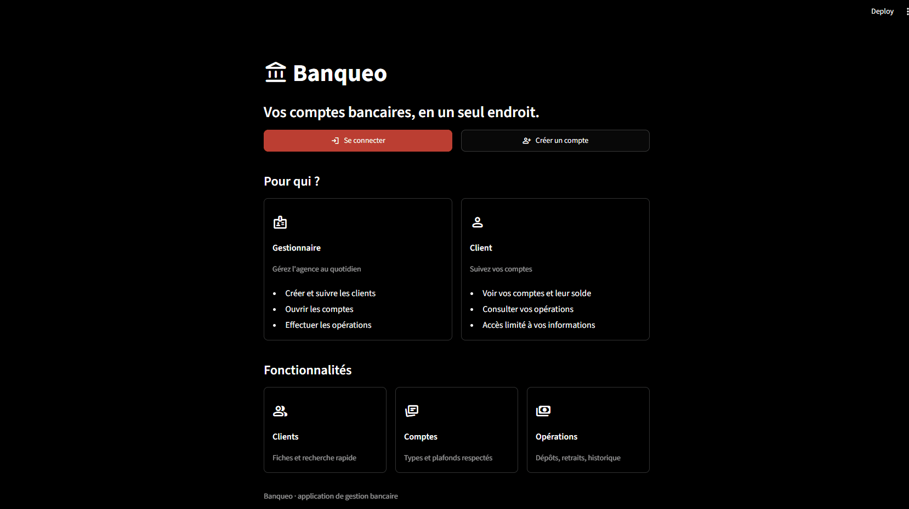
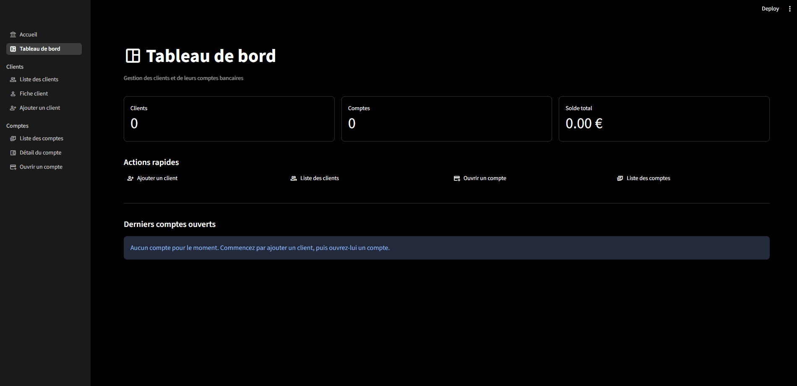
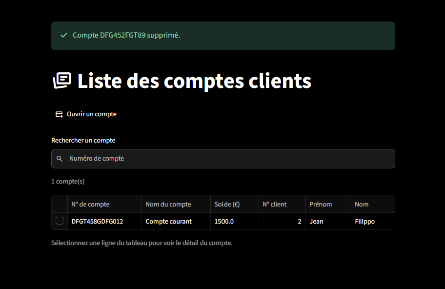
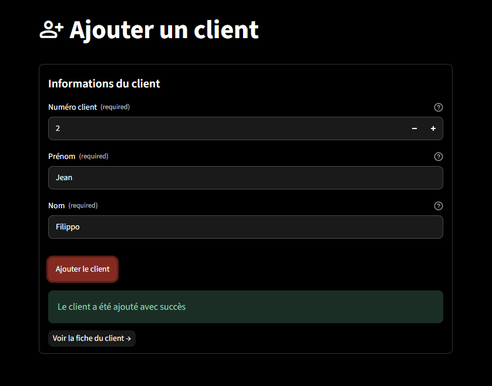
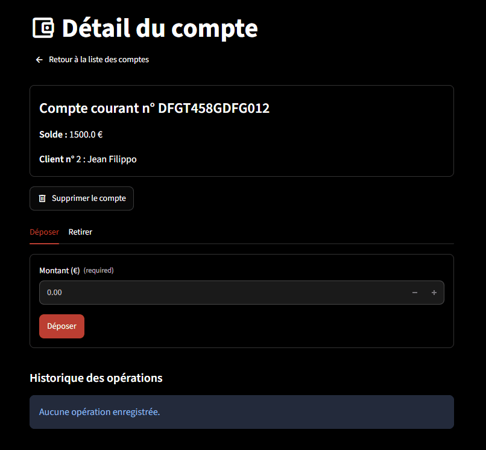
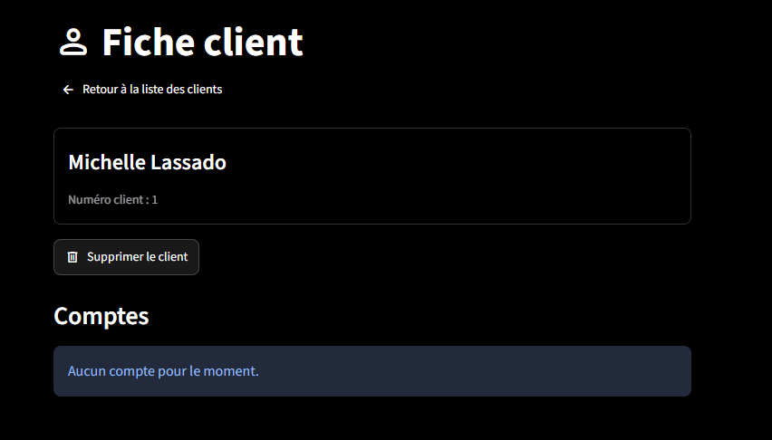

# Banqueo


Banqueo est une application web de gestion bancaire simplifiée. Elle permet aux **gestionnaires** d'une agence de gérer les clients et leurs comptes et prévoit un espace **client** pour consulter ses propres comptes.

#### Aperçus : 

| Accueil | Tableau de bord | Liste des comptes
|:---:|:---:|:---:|
|  |  | 

| Ouverture d'un compte | Détail d'un compte | Compte client
|:---:|:---:|:---:|
|  |  | 

<hr>

L'application est née d'un programme en console (`main.py`) et s'est enrichie
d'une API web (FastAPI) et d'une interface graphique (Streamlit). La logique
métier reste dans le dossier `bank/`, partagée par toutes les interfaces.

Les utilisateurs peuvent :
- créer des clients et leur ouvrir des comptes bancaires avec un type de compte et un plafond, 
- déposer ou retirer de l'argent dans la limite du plafond et du solde, 
- consulter l'historique des opérations de chaque compte, 
- supprimer un compte ou un client avec tous ses comptes, 
- suivre l'activité de la banque depuis le tableau de bord.

> Rôles prévus : 
- **gestionnaire** : accès à toutes les pages 
- **client** : accès limité à ses propres comptes

TODO: authentification (2 rôles)


## Objectifs 

- POO en Python : classes, objets, encapsulation, méthodes
- Logique métier : validation des opérations et gestion des erreurs
- Architecture modulaire : `bank/` (métier), `api.py` (API), `pages/` et `services/` (interface)
- Tests unitaires et documentation
- Versionner le projet avec Git et isoler les dépendances dans un `venv`


## Architecture

```
banqueo/
├── bank/              # logique métier (Bank, Client, Account)
├── api.py             # API REST FastAPI (port 8001)
├── services/          # appels à l'API depuis l'interface (requests)
├── pages/             # pages Streamlit (Accueil, Clients, Comptes, Tableau de bord)
├── app_streamlit.py   # point d'entrée Streamlit et menu de navigation
├── main.py            # ancienne interface console
└── tests/             # tests unitaires (unittest)
```

- L'interface Streamlit n'accède jamais directement à `bank/` : elle passe par l'API.
- Les `ValueError` levées par `bank/` sont converties en codes HTTP (400, 404, 409).
- Les modèles Pydantic (`ClientIn`, `AccountIn`, `AmountIn`) valident le JSON reçu.


## Prérequis

- Python 3.11.9
- Pip 26.2.1
- Pour les icônes : [Material Symbols](https://fonts.google.com/icons)

### Environnement virtuel

```
# Créer un environnement virtuel
python -m venv venv

# Activer l'environnement (Windows)
venv\Scripts\activate

# Désactiver l'environnement
deactivate
```

### Dépendances

```
# Installer un package
pip install nom_du_package

# Créer requirements.txt
pip freeze > requirements.txt

# Installer à partir de requirements.txt
pip install -r requirements.txt
```


## Lancer l'application

Il faut deux terminaux, avec le `venv` activé dans chacun.

```
# Terminal 1 : lancer l'API (port 8001)
uvicorn api:app --reload --port 8001

# Terminal 2 : lancer l'interface web
streamlit run app_streamlit.py
```

Puis ouvrir http://localhost:8501

- Swagger UI (tester les endpoints) : http://127.0.0.1:8001/docs
- ReDoc (lecture seule) : http://127.0.0.1:8001/redoc

> Les données sont en mémoire : elles sont perdues au redémarrage de l'API.
> TODO:  base de données 


## Tests

```
python -m unittest discover
```

Ou un fichier précis : `python -m unittest tests.test_client`


## Logs

Niveaux standards du module `logging` :

```
DEBUG     logger.debug()
INFO      logger.info()
WARNING   logger.warning()
ERROR     logger.error()
CRITICAL  logger.critical()
```